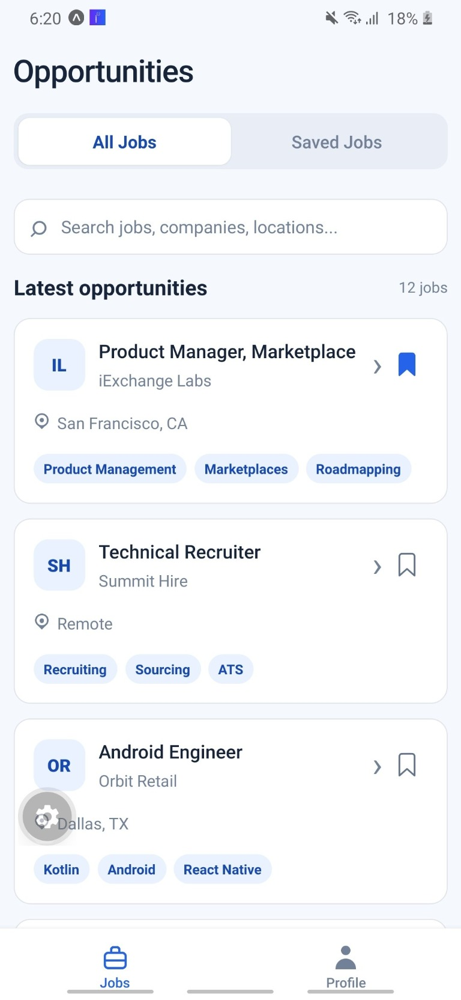
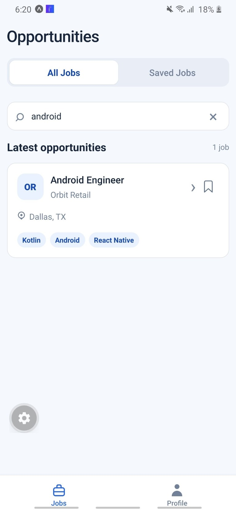
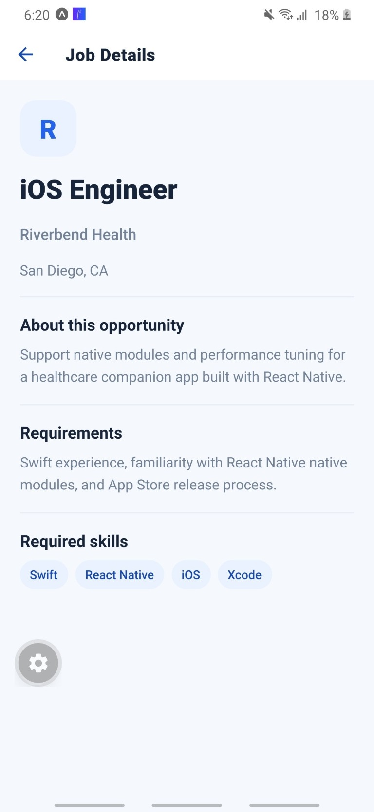
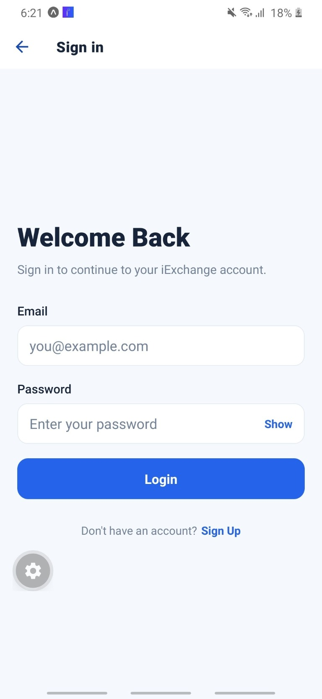
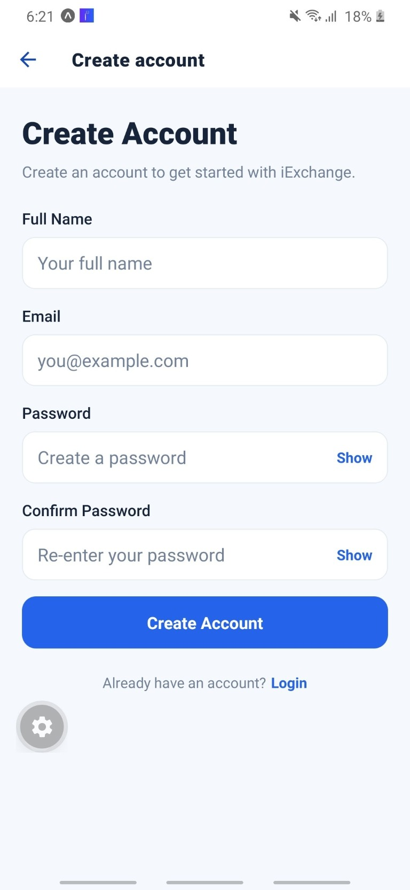
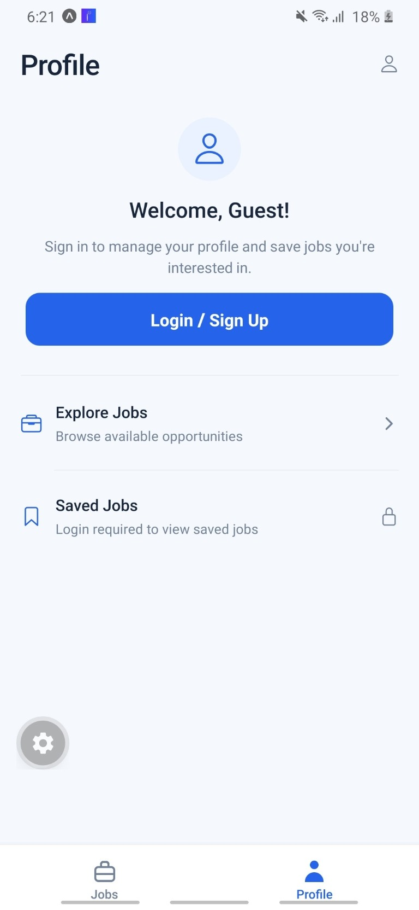

# iExchange Mobile Application

## 1. Project Overview

iExchange is a mobile job-opportunities application developed as a full-stack technical assessment for an AI-Native Full-Stack Mobile Developer role. The application pairs an Expo/React Native client with a TypeScript REST API and a local SQLite database.

Guests can browse and search opportunities. Users can create an account, sign in, save jobs, and manage their saved jobs and profile.

## 2. Key Features

- User registration and login
- Logout and persistent login session
- JWT-based authentication for protected API requests
- Browse all jobs and search by job, company, location, or skills
- View job details
- Save and unsave jobs
- View and manage Saved Jobs
- Guest and authenticated Profile states
- Loading, error, retry, and empty states for data-driven screens
- Saved-job state shared across the Jobs experience and cleared when the session changes

## 3. Technology Stack

| Area | Technologies |
|---|---|
| Frontend | React Native, Expo, TypeScript |
| Navigation and UI | React Navigation, Expo Vector Icons, Safe Area Context |
| Backend | Node.js, Express.js, TypeScript |
| Database | SQLite with `better-sqlite3` |
| Authentication | JSON Web Tokens (`jsonwebtoken`), password hashing with `bcryptjs`, Expo SecureStore on the client |
| API integration | Fetch API |
| Development tools | VS Code AI Agent, npm, Git, GitHub |
| Testing and verification | Postman, Android device/emulator, TypeScript checks, Expo lint |

## 4. Project Architecture

The frontend calls the backend over HTTP. Express routes pass requests to controllers and services; services read and write SQLite through the database module.

```text
┌──────────────────────────────────┐
│ Expo / React Native application  │
│ Screens · Navigation · Contexts  │
└────────────────┬─────────────────┘
                 │ Fetch / JSON
                 │ Bearer JWT for protected routes
                 ▼
┌──────────────────────────────────┐
│ Express REST API                 │
│ Routes → Controllers → Services  │
└────────────────┬─────────────────┘
                 │ better-sqlite3
                 ▼
┌──────────────────────────────────┐
│ Local SQLite database            │
│ Jobs · Users · Saved Jobs         │
└──────────────────────────────────┘
```

```text
.
├── frontend/
│   ├── src/
│   │   ├── components/   # Shared controls, job card, theme, and tab icon
│   │   ├── context/      # Authentication and saved-job state
│   │   ├── navigation/   # Root stack and bottom-tab navigators
│   │   ├── screens/      # Jobs, details, authentication, and profile screens
│   │   ├── services/     # Fetch API, authentication, and jobs clients
│   │   └── types/        # Navigation and API domain types
│   ├── app.json
│   └── package.json
└── backend/
    ├── src/
    │   ├── config/       # Environment configuration
    │   ├── controllers/  # HTTP request/response handling
    │   ├── database/     # SQLite initialization, schema, and job seeds
    │   ├── middleware/   # Authentication and error handling
    │   ├── routes/       # Health, auth, and jobs endpoints
    │   └── services/     # Business logic and data access
    └── package.json
```

## 5. Frontend Implementation

- **Navigation:** React Navigation uses a root native stack for the main tab navigator, Job Details, Login, and Signup.
- **Primary tabs:** The bottom tab bar contains Jobs and Profile and uses a horizontal shift transition.
- **Jobs subtabs:** Jobs contains All Jobs and Saved Jobs panes, which slide horizontally when selected.
- **Job Details:** Selecting a job opens the existing Job Details route with the job ID; the screen loads that job from the API.
- **Authentication context:** `AuthContext` restores, exposes, and clears the authenticated user and token. It shows a loading state while restoring the session.
- **Persistent session:** The session is stored with Expo SecureStore. Logout deletes the stored session before clearing in-memory authentication state.
- **Fetch integration:** Shared API helpers build requests from `EXPO_PUBLIC_API_BASE_URL`, parse JSON responses, and surface HTTP/network errors. Protected requests include a Bearer token.
- **Debounced search:** All Jobs waits 300 ms after input changes before searching. Request sequence checks prevent older responses from replacing newer search results.
- **Bookmark state:** `SavedJobsContext` owns the saved-job list and IDs, coordinates save/unsave requests, prevents duplicate mutations, and scopes state to the authenticated user. The All Jobs and Saved Jobs screens use this shared state.
- **Guest behavior:** Guests can browse jobs and details. Saving or opening Saved Jobs prompts them to log in rather than sending protected requests without a token.

## 6. Backend Implementation

- **Express server:** `backend/src/index.ts` initializes the database and starts the API on the configured port.
- **Routes, controllers, and services:** Routes map HTTP endpoints to controllers. Controllers validate/extract request data and format responses; services implement authentication, job, and database operations.
- **SQLite:** The database module opens the configured SQLite file, enables WAL mode and foreign keys, and creates the `jobs`, `users`, and `saved_jobs` tables when needed.
- **Database seeding:** Startup seeds fictional job opportunities when they are not already present.
- **JWT middleware:** Protected Saved Jobs routes use `requireAuth`, which validates a Bearer JWT and makes the authenticated user ID available to the controller.
- **Password handling:** Passwords are hashed with bcryptjs before storage. Authentication responses return public user fields rather than password hashes.
- **Error handling:** Central middleware returns structured JSON errors for application errors, malformed JSON, missing routes, and unexpected server errors.

## 7. API Endpoints

All endpoints are prefixed with `/api`. Protected requests require `Authorization: Bearer <token>`.

| Method | Endpoint | Description | Authentication |
|---|---|---|---|
| `GET` | `/api/health` | API health status | Not required |
| `POST` | `/api/auth/register` | Create an account and return a session | Not required |
| `POST` | `/api/auth/login` | Authenticate and return a session | Not required |
| `GET` | `/api/jobs` | List jobs; optional `?search=<query>` searches available job fields | Not required |
| `GET` | `/api/jobs/:id` | Retrieve one job by ID | Not required |
| `GET` | `/api/jobs/saved` | List the authenticated user's saved jobs | Bearer JWT |
| `POST` | `/api/jobs/:id/save` | Save a job for the authenticated user | Bearer JWT |
| `DELETE` | `/api/jobs/:id/save` | Remove a saved job | Bearer JWT |

Logout is currently handled on the client by deleting the locally stored session. There is no separate backend logout endpoint.

## 8. Installation and Setup

### Prerequisites

- Node.js and npm
- Git
- Android Studio/Android SDK for a local Android build, or an Android device with Expo Go for development

On Windows, native `better-sqlite3` installation may require a compatible prebuilt binary or the Visual Studio C++ build tools.

### Clone the repository

```powershell
git clone https://github.com/chaitu0626/iexchange-mobile-assessment.git
Set-Location iexchange-mobile-assessment
```

### Configure and start the backend

```powershell
if (-not (Test-Path backend\.env)) { Copy-Item backend\.env.example backend\.env }
```

Edit `backend\.env`. Set `JWT_SECRET` to a long, random value for local development. Keep `.env` files private; do not commit them.

The example configures port `3000`, a local SQLite database at `./data/app.db`, and a one-week JWT lifetime. From the backend directory:

```powershell
Set-Location backend
npm ci
npm run dev
```

The API should be available at `http://localhost:3000/api`.

### Configure and start the frontend

In a second terminal, from the repository root:

```powershell
if (-not (Test-Path frontend\.env)) { Copy-Item frontend\.env.example frontend\.env }
```

Set `EXPO_PUBLIC_API_BASE_URL` in `frontend\.env` to the API base URL reachable from the Android runtime:

- **Android emulator:** `http://10.0.2.2:3000/api` routes to the host computer's localhost.
- **Physical Android device:** use `http://<computer-LAN-IP>:3000/api`. The device and computer must be on the same network, and the backend port must be reachable through the firewall. Do not use `localhost` or `10.0.2.2` from a physical device.

Then install and start the Expo app:

```powershell
Set-Location frontend
npm ci
npm start
```

Use the Expo CLI prompt to open the app on an Android emulator/device or scan the development QR code with Expo Go. To build and launch the native Android app through the local Android toolchain instead, run the configured script:

```powershell
npm run android
```

### TypeScript and lint checks

Run each command from the corresponding package directory:

```powershell
# From the repository root
Set-Location frontend
npx tsc --noEmit
npm run lint

# Back to the repository root, then into the backend package
Set-Location ..
Set-Location backend
npx tsc --noEmit
```

## 9. Testing

- **Backend API:** Postman was used to test the API, including authentication and jobs workflows.
- **Android functional and integration testing:** The Android application was tested across navigation, Login, Signup, Search, Job Details, Saved Jobs, and Profile flows. Testing used the existing 57-case Android test plan. Detailed execution results are maintained separately; this README does not state pass/fail totals.
- **Static checks:** TypeScript checks were run for the frontend and backend with `npx tsc --noEmit`. Frontend lint verification uses `npm run lint` from `frontend`. Detailed verification results are maintained separately.

## 10. AI-Assisted Development

The VS Code AI Agent assisted with implementation, debugging, and verification. Detailed prompts, manual corrections, and verification steps will be maintained in a separate `AI_USAGE.md` document.

## 11. Screenshots

### All Jobs

Browse the available job opportunities.



### Search

Search jobs and review matching opportunities.



### Job Details

Review a selected job's description, requirements, and skills.



### Login

Sign in to an existing account.



### Signup

Create an account using the registration form.



### Saved Jobs

View opportunities saved to the signed-in user's account.


### Guest Profile

Explore the profile screen before signing in.



### Logged-in Profile

Replacement screenshot needed. The submitted image showed personal identifying information and was not added.

## 12. Known Limitations

- This assessment setup uses a locally managed SQLite database and a development API; it is not a hosted production service.
- Job opportunities are fictional, locally seeded assessment data rather than live listings from an external jobs provider.
- Android development networking uses HTTP and the app permits cleartext traffic for the local API. Production deployment should use HTTPS and production-appropriate network/security configuration.
- Detailed execution results for the referenced 57-case Android test plan are maintained separately and are not included in this repository.

## 13. Assessment Scope

The application demonstrates a full-stack mobile job-browsing and saved-jobs flow using fictional job data and a locally managed backend/database. It is an assessment implementation, not a connection to iExchange's production systems or live job inventory.
